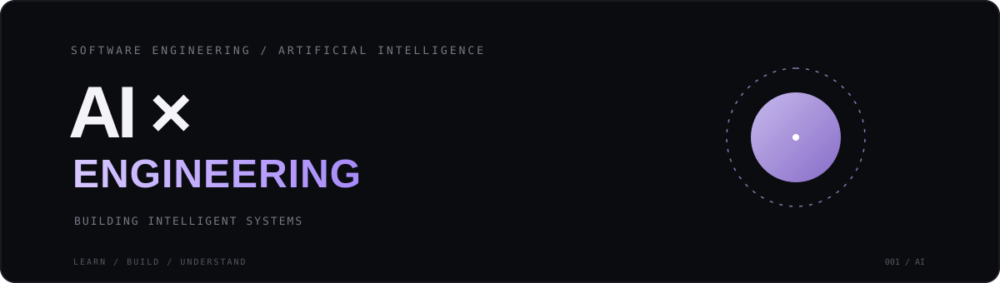

<!-- =============================== -->
<!--          PROFILE HERO            -->
<!-- =============================== -->

  

  <b>Software Developer · Backend AI · Intelligent Systems</b>

  Building practical systems at the intersection of software engineering and AI.

---

## About

I'm a software developer interested in building reliable backend systems and exploring practical AI engineering.

My focus is on understanding how intelligent applications work beyond the model itself, from backend architecture and data retrieval to agent workflows and evaluation.

## Focus Areas

| Area | Exploring |
|---|---|
| Backend Engineering | Python, APIs, system design |
| Generative AI | LLMs, prompt engineering |
| Retrieval Systems | RAG, embeddings, vector search |
| AI Agents | Tool calling, agentic workflows |
| AI Engineering | Evaluation, observability, reliability |

## Currently Building & Learning

- Designing AI-powered backend applications.
- Exploring reliable LLM integrations.
- Learning RAG and retrieval architectures.
- Experimenting with AI agents and tool calling.
- Understanding production-grade AI systems.

## Selected Projects

<!-- Replace these with actual projects -->

- **Project 01** — Coming soon.
- **Project 02** — Coming soon.
- **Project 03** — Coming soon.

## Connect

  <a href="https://github.com/">
    GitHub
  </a>
  &nbsp; · &nbsp;
  <a href="https://www.linkedin.com/">
    LinkedIn
  </a>

---

  Learn continuously. Build thoughtfully. Engineer with purpose.

